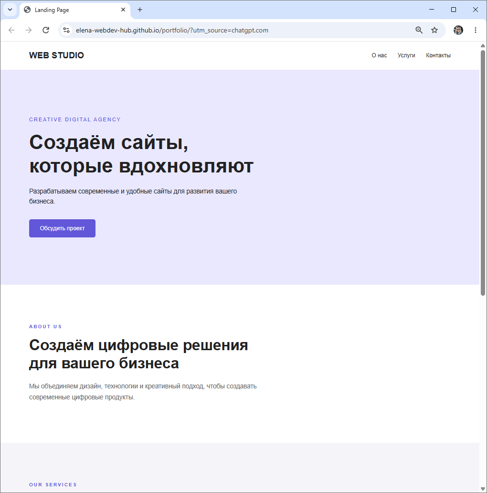

# WEB STUDIO — Landing Page


Адаптивный сайт для вымышленного digital-агентства WEB STUDIO.

## Live Demo

[Посмотреть опубликованный сайт](https://elena-webdev-hub.github.io/portfolio/)

## О проекте

Проект представляет собой современный landing page с адаптивной версткой, интерактивным мобильным меню и плавной навигацией между разделами.

## Используемые технологии

- HTML5
- CSS3
- JavaScript

## Реализованные возможности

- Семантическая HTML-разметка
- Адаптивная верстка для мобильных устройств и планшетов
- CSS Grid и Flexbox
- Мобильное навигационное меню
- Интерактивность на JavaScript
- Плавная прокрутка страницы
- CSS-анимации и эффекты наведения
- Секции About, Services, Contacts и Footer

## Структура проекта

```text
landing-page/
├── index.html
├── style.css
├── script.js
└── README.md
```

## Автор

Elena — Email Developer / Frontend Developer